# CampusAccessControlAttendance
校园门禁考勤管理系统  系统亮点：考勤规则匹配、签到签退判定、连续缺勤预警、 频繁异常预警、考勤申诉闭环、ECharts分析； 

本文注重于计算机毕业设计选题指导，列出题目均有源码， 大家可以去【公众号】(毕业终点站)获取或者加我【qq】(2112698948)提意见(别忘记Star哟)。备注：git

声明：仅用于学习使用，请勿用于任何商业行为！

1.系统非商用，非开源，非无偿。

2.由本人开发，如需源码，请联系以下方式，qq:2112698948。

3.项目有很多，并未全部上传，如果未找到想要的，可直接咨询。

# 校园门禁考勤管理系统

**考勤规则匹配 · 签到签退判定 · 连续缺勤预警 · 频繁异常预警 · 考勤申诉流程 · ECharts 统计分析**

Spring Boot 3 + Vue 3 + Element Plus + ECharts + MySQL

---

<b>系统登录页：学生 / 老师 / 管理员三种登录身份，统一入口</b>

## 一、项目介绍

一套面向校园日常管理的门禁考勤系统，覆盖「设备通行 → 考勤判定 → 异常预警 → 申诉处理 → 统计分析」的完整流程。学生、老师、管理员三种角色，Web 前台 + 管理后台分离。

### 1.1 技术栈

| 分类 | 技术 |
| --- | --- |
| 架构 | B/S、MVC、前后端分离、三角色（学生/教师/管理员） |
| 后端 | Java、Spring Boot 3、Spring MVC、MyBatis-Plus、MySQL、JWT、Spring 定时任务、Apache POI |
| 前端 | Vue 3、Vite、Element Plus、Vue Router、Pinia、Axios、ECharts、SCSS |
| 开发环境 | IDEA、JDK 17、Maven、Node.js、Windows |

### 1.2 系统亮点

- **考勤规则匹配**：结合考勤周期和适用对象生成考勤计划，支持全校日常考勤、院系晚自习、班级课程等不同场景。
- **签到签退判定**：在规则时段内匹配首次进入与最后离开的通行记录，结合分钟阈值计算正常、迟到、早退、缺勤状态，支持定时任务自动重算。
- **连续缺勤预警**：定时检查连续缺勤记录，达到配置阈值后自动生成预警，方便老师及时跟进。
- **频繁异常预警**：分别统计近 30 天迟到、早退次数，按阈值触发预警，通过唯一标记避免同一预警重复生成。
- **考勤申诉流程**：异常记录可关联申诉原因与证明材料，老师或管理员审批，学生可随时跟踪待审批、已通过、已驳回状态。
- **ECharts 统计分析**：覆盖校园整体、院系、班级、个人、设备多个视角，通过趋势、占比、排名和热力图查看考勤情况。

### 1.3 功能一览

**管理员端**

- 数据仪表盘：用户总数、今日考勤、设备在线情况、出勤率趋势、考勤状态分布、时段通行分布、本周预警统计
- 人员与班级管理：用户、学生、教师、班级信息维护，密码重置
- 门禁设备管理：设备名称、编号、安装位置、类型、在线状态、最后通信时间
- 考勤规则管理：签到签退时段、迟到早退阈值、每周考勤周期、全体/指定院系/指定班级适用范围、启停配置
- 考勤与通行管理：记录查询、条件筛选、分页展示，用户/学生/教师/考勤/通行数据 Excel 导出
- 异常与申诉管理：连续缺勤、频繁迟到、频繁早退预警规则配置，预警处理备注，考勤申诉审批
- 统计分析：考勤状态占比、出勤率趋势、院系考勤对比、班级排名、每周考勤热力图、设备通行对比、通行方式分布

**学生端**

- 注册登录、找回密码、个人信息维护、头像上传、手机号与邮箱修改、密码修改
- 首页查看今日签到签退、本周考勤、本月统计及最近通行记录
- 个人考勤列表与详情，对异常考勤提交申诉、上传证明材料并跟踪审批结果
- 个人通行记录与设备详情，按月查看考勤月报及状态分布
- 手动考勤：选择在线门禁设备模拟进入/离开，生成通行记录并联动更新考勤

**教师端**

- 个人考勤、通行查询、考勤月报、手动考勤、个人中心
- 所带班级考勤查询，按日期、学生、考勤状态筛选
- 班级考勤统计、学生考勤排名、学生异常申诉审批及意见填写

## 二、学生端

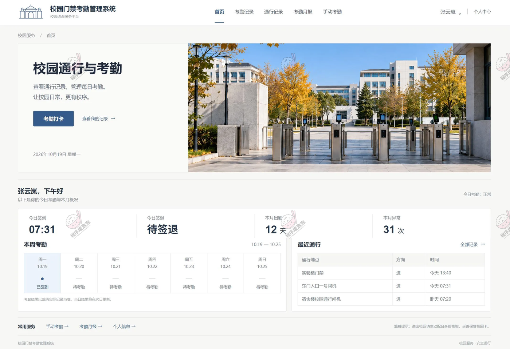

<b>学生首页：今日签到/签退状态、本周考勤日历、本月出勤与异常、最近通行记录</b>

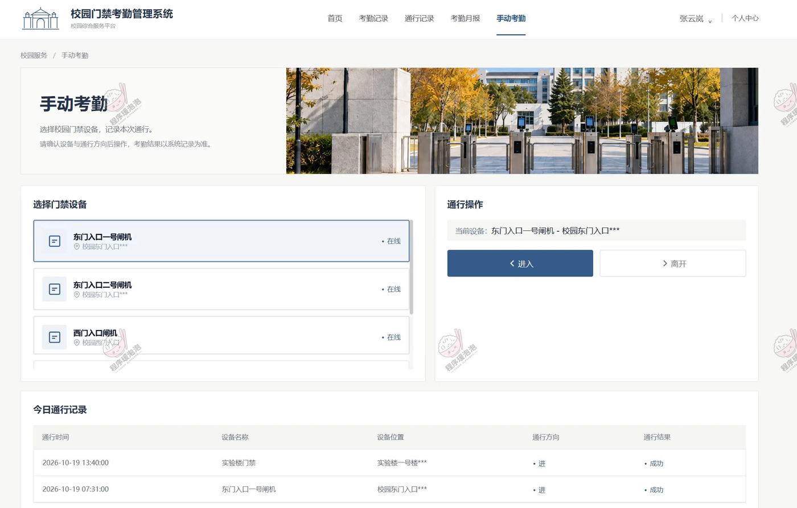

<b>手动考勤：选择在线门禁设备与通行方向，模拟刷卡进出，即时生成通行记录并联动考勤</b>

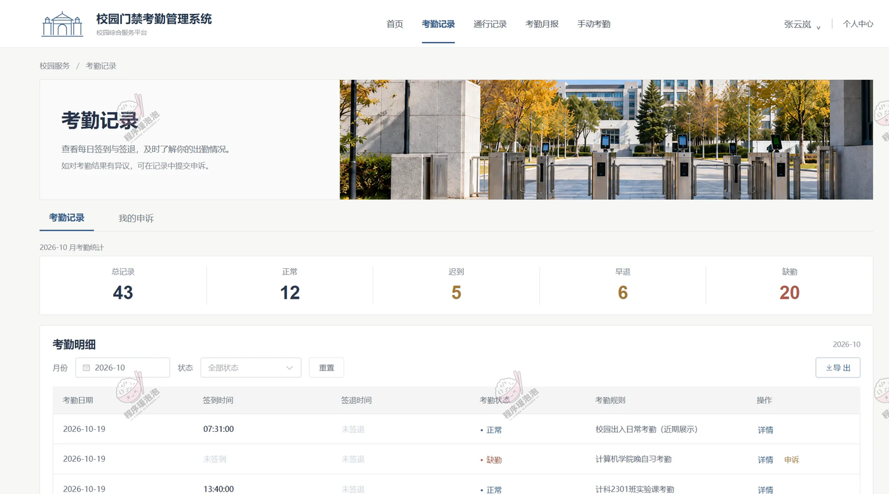

<b>考勤记录：按月统计正常/迟到/早退/缺勤，明细列表支持按状态筛选，异常记录可直接发起申诉</b>

<b>通行记录：进出次数与总记录数概览，按设备、日期、方向检索每一次校园出入</b>

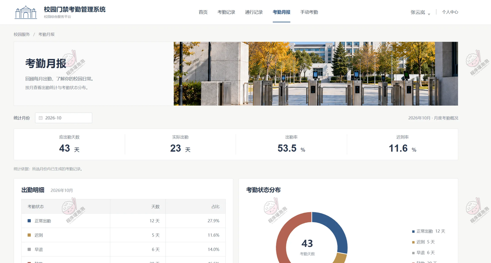

<b>考勤月报：按月查看出勤率、迟到率、应出勤/实际出勤天数与考勤状态分布</b>

## 三、教师端

> 学生的功能老师端同样具备，这里展示教师特有的班级管理部分。

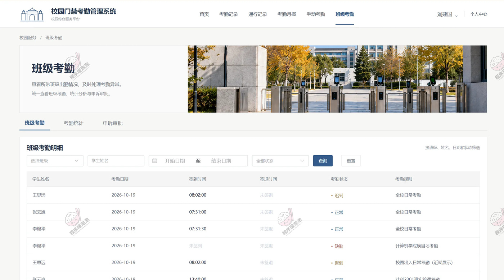

<b>班级考勤明细：按班级、学生姓名、日期区间、考勤状态组合筛选所带班级的考勤记录</b>

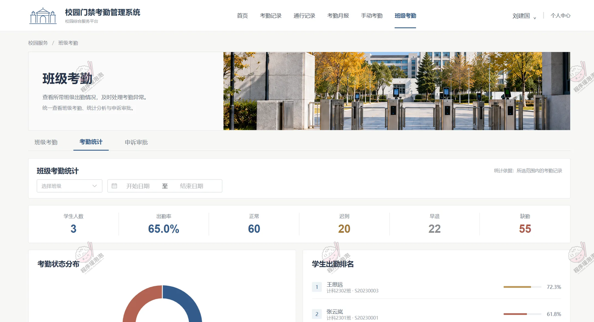

<b>班级考勤统计：班级出勤率、正常/迟到/早退/缺勤汇总，学生出勤排名与考勤状态分布图</b>

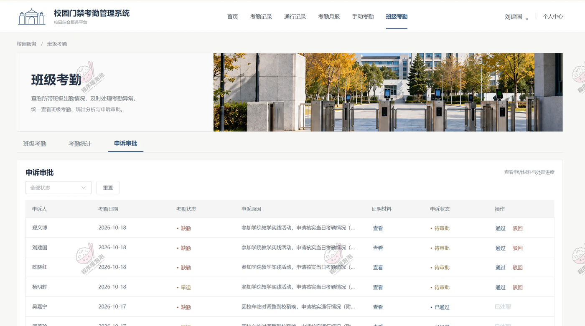

<b>申诉审批：查看学生提交的申诉原因与证明材料，一键通过/驳回并填写审批意见</b>

## 四、管理员端

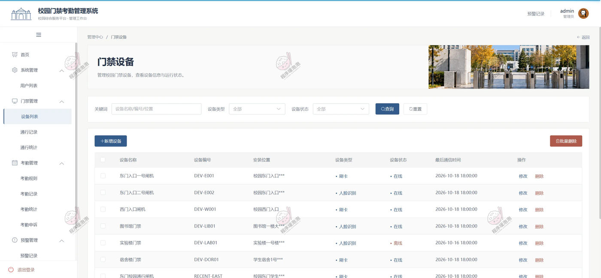

<b>门禁设备列表：设备名称、编号、安装位置、类型、在线状态与最后通信时间，支持新增/修改/批量删除</b>

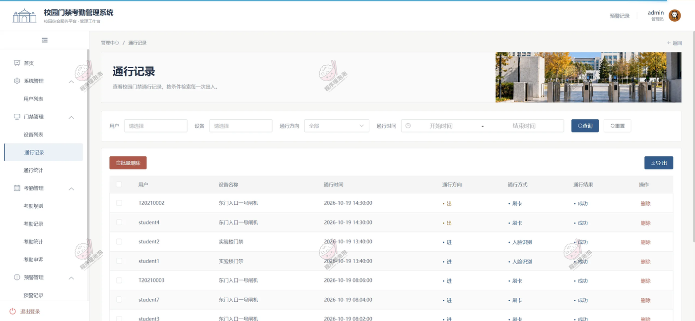

<b>通行记录管理：按用户、设备、时间区间、通行方向检索全校园出入记录，支持 Excel 导出</b>

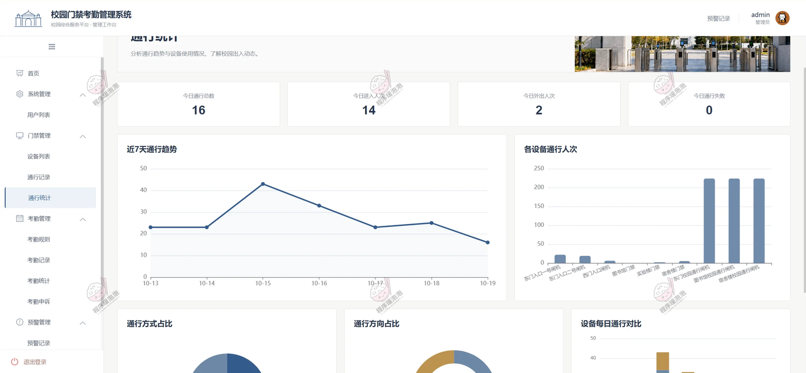

<b>通行统计：今日通行总数/进入/外出/失败概览，近 7 天通行趋势、各设备通行人次、方式与方向占比</b>

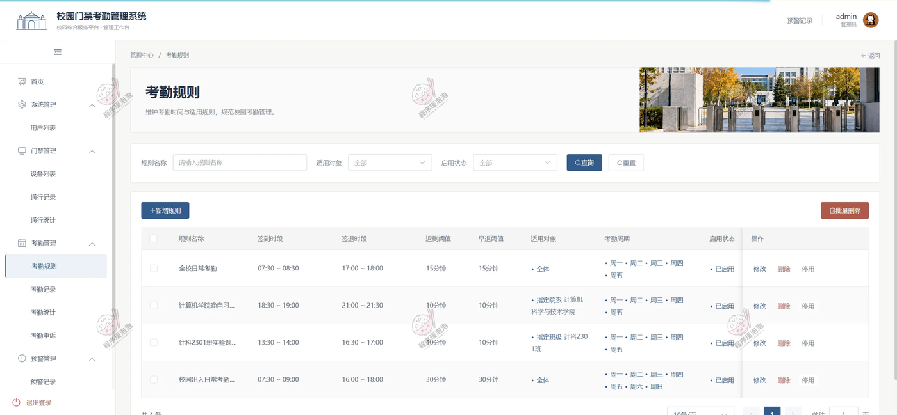

<b>考勤规则管理：签到签退时段、迟到早退阈值、每周考勤周期，适用对象支持全体/指定院系/指定班级</b>

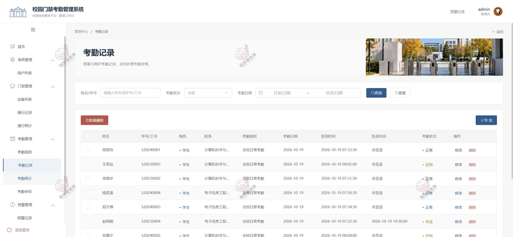

<b>考勤记录管理：按姓名/学号、日期、状态查询全校考勤明细，联动修改与删除</b>

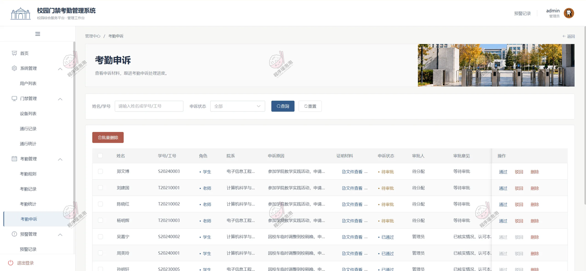

<b>考勤申诉管理：查看申诉原因、证明材料与审批进度，老师/管理员可代为审批处理</b>

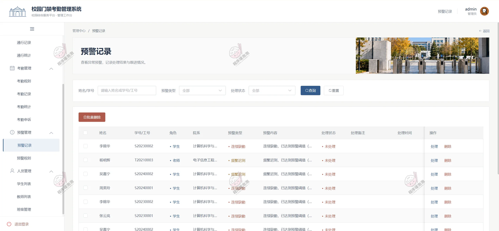

<b>预警记录管理：连续缺勤、频繁迟到/早退预警列表，按类型与处理状态筛选，记录处理备注与跟进情况</b>

---

## 五、总结

这套系统把「门禁硬件通行数据」和「考勤管理」真正打通：通行记录进来后，按考勤规则自动匹配出每个人的签到签退结果，迟到、早退、缺勤由阈值自动判定，定时任务还会定期重算兜底。异常不用靠人盯——连续缺勤和频繁迟到/早退达到阈值自动出预警，学生有异议可以走申诉流程附上证明材料，老师审批完状态实时可查。最后通过 ECharts 从校园、院系、班级、个人、设备多个角度出报表，整个流程在系统里就能走完。

- 后端：Spring Boot 3 + MyBatis-Plus + JWT，定时任务负责考勤重算与预警生成，Apache POI 支持 Excel 导出
- 前端：Vue 3 + Element Plus + Pinia + ECharts，Vite 构建
- 数据：MySQL，涵盖用户、班级、设备、考勤规则、考勤记录、通行记录、预警、申诉等核心表

> 文档展示 16 张截图，需要了解更多，请联系我。
